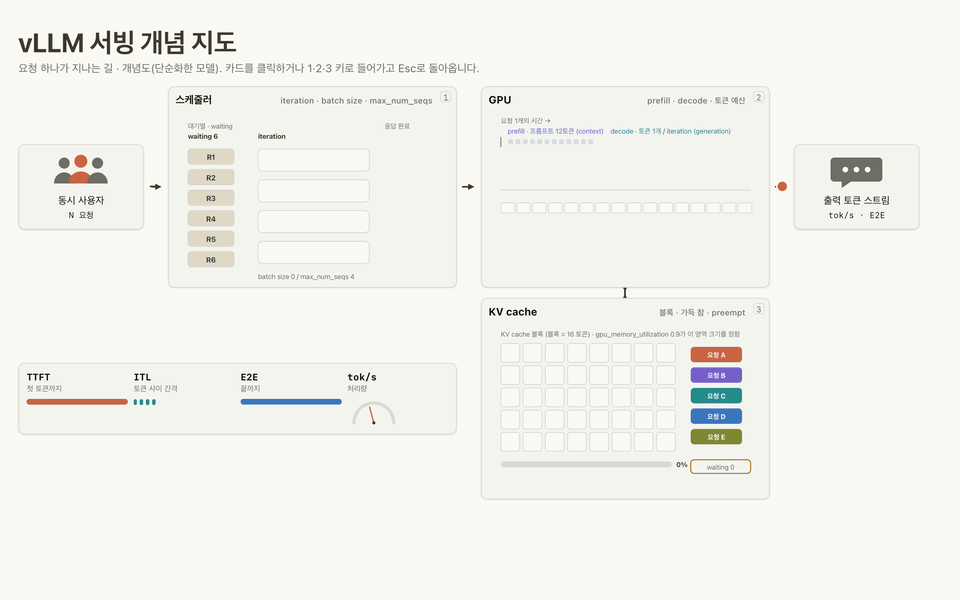

<p align="center">
  
</p>

<p align="center"><strong>EIDOS</strong></p>

<h1 align="center"><em>Make Meaning Visible.</em></h1>

<p align="center">
  Ask how something works. Get an animated, self-contained HTML scene you can step through.
</p>

<p align="center">
  
  
  
  
  <a href="LICENSE"></a>
</p>

<p align="center">
  <b>English</b> | <a href="README.ko.md">한국어</a>
</p>

<p align="center">
  
</p>
<p align="center">
  <sub>From <code>skills/eidos-visualize/examples/vllm-serving.html</code>: the camera dives from the system map into the KV cache, blocks fill, a request is preempted, and memory comes back.</sub>
</p>

## Make Meaning Visible

*Eidos* (εἶδος) is the Greek word Plato used for *form*: what a thing truly is, grasped as something seen. EIDOS takes the word literally. Ask it how something works and the answer comes back as a scene you watch and step through, not a wall of text you have to picture in your head.

Three principles shape every scene:

- **Understanding over information.** The goal is that you understand, not that more gets said.
- **Show, don't tell.** Camera moves, cuts and diagrams carry the explanation. Text only labels it.
- **Human pace.** You decide when the next idea arrives.

## Highlights

**How meaning becomes visible**

- The grammar of film and motion graphics: camera moves, cuts, motion and explainer diagrams such as sequence diagrams, state machines, code diffs and charts.
- 64 techniques, each with a card, an implementation and a live template. See [Technique library](#technique-library).
- One self-contained HTML file. No server and no dependencies: open it in a browser or send it to someone.

**You set the pace**

- Step through the explanation one idea at a time, or let it autoplay at 0.5× to 2×.
- Some explainers add a control dock with sliders and toggles. Change an input and watch the scene react.
- Reduced motion is respected, and light and dark themes are built in.

## Quick start

**Claude Code**

```bash
# from the marketplace in this repository
/plugin marketplace add donghae0414/eidos
/plugin install eidos@eidos

# or load a local checkout for one session
git clone https://github.com/donghae0414/eidos.git
claude --plugin-dir ./eidos
```

**Codex**

```bash
codex plugin marketplace add donghae0414/eidos   # or a local checkout path
codex plugin add eidos@eidos
```

**pi / omo**

EIDOS is also a [pi package](https://pi.dev), so it works in pi and in pi-based harnesses such as omo (senpi). The skills call `node` and `bun`, so both need to be on your PATH.

```bash
pi install git:github.com/donghae0414/eidos    # or: omo install git:github.com/donghae0414/eidos
# add -l to install for the current project only

# or try it for one session without installing
pi -e git:github.com/donghae0414/eidos
```

Then ask for a visual explanation and open the file it writes:

```text
Visualize the OAuth 2.0 authorization code flow and save it as oauth.html
```

## Controls

| Input | Action |
|---|---|
| `→` `↓` `Space` `Enter` `PageDown`, click, mouse wheel burst, swipe | Next step |
| `←` `↑` `Backspace` `PageUp` | Previous step |
| `Home` / `End` | First / last step |
| `R` | Replay from the start |
| `P` | Play / pause |
| `[` / `]` | Slower / faster (0.5, 1, 1.5, 2) |
| `1`-`9` / `Esc` | Enter a numbered detail / return to the overview, when a scene offers them |

## Examples

Each example is a single HTML file with the storyboard it was built from, in [`skills/eidos-visualize/examples/`](skills/eidos-visualize/examples/). Download one and open it in a browser. The example content is written in Korean.

| Example | What it explains |
|---|---|
| [`vllm-serving`](skills/eidos-visualize/examples/vllm-serving.html) | How vLLM serves requests: scheduler, prefill and decode, KV cache, and a lab with sliders for concurrency and throughput |
| [`oauth-flow`](skills/eidos-visualize/examples/oauth-flow.html) | The OAuth 2.0 authorization code flow, why the client secret matters, and how PKCE replaces it |
| [`rest-vs-graphql`](skills/eidos-visualize/examples/rest-vs-graphql.html) | Round trips and response shape in REST and GraphQL, with controls for the number of fields |

## Technique library

| Group | Count | Examples |
|---|---:|---|
| Camera | 16 | `zoom-in`, `dolly-zoom`, `orbit`, `fly-to`, `rack-focus`, `ken-burns` |
| Cut | 14 | `match-cut`, `whip-pan`, `iris`, `smash-cut`, `split-screen`, `zoom-through` |
| Motion | 8 | `path-drawing`, `shape-morph`, `particle-assemble`, `count-up`, `spotlight` |
| Explainer | 16 | `sequence-message`, `state-transition`, `code-diff`, `chart-morph`, `next-token`, `context-window` |
| Type | 10 | `kinetic-type`, `text-scramble`, `typing-caret`, `highlight-sweep`, `mask-reveal` |

Each technique lives in `skills/eidos-<group>/techniques/<name>/` with a `card.md`, a `technique.js` and a `template.html` you can open directly.

## Update

Each release bumps the plugin version. Refresh the marketplace, then update the plugin:

**Claude Code**

```bash
claude plugin marketplace update eidos
claude plugin update eidos@eidos   # restart Claude Code to apply
```

**Codex**

```bash
codex plugin marketplace upgrade eidos
codex plugin remove eidos@eidos && codex plugin add eidos@eidos
```

**pi / omo**

A git install without a ref follows the default branch, so updating pulls the latest version:

```bash
pi update --extensions    # or: omo update --extensions
```

## Contributing

Repository layout, QA commands and pull request guidelines are in [CONTRIBUTING.md](CONTRIBUTING.md).

## License

[MIT](LICENSE)
